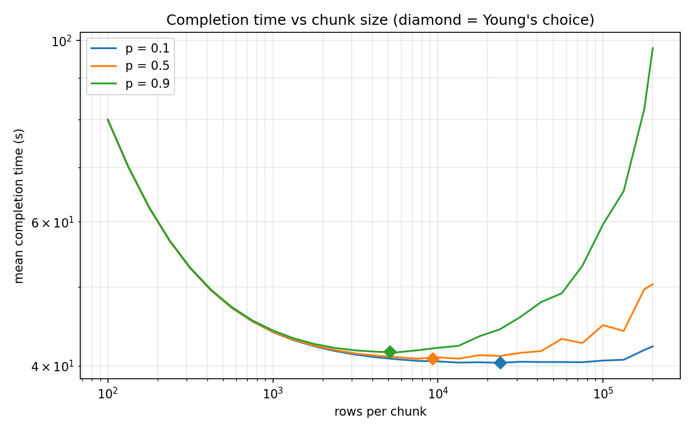

# ChunkSafe

A compiler for **interruption-safe database reorganization** on mobile edge databases (SQLite).

Mobile devices lose connectivity or get killed mid-task. ChunkSafe takes a tiny language for reorganization jobs and compiles it into **chunked, retry-safe SQL** that can be stopped at any point and resumed without corrupting data.

```
REINDEX orders ON (region, ts);
REPARTITION trips BY zone;
UPDATE stats SET views = visits * 2;
UPDATE stats SET visits = visits + 1;   -- rejected at compile time: reads and writes the same column
```

## How it works
1. **Parse** the `.reorg` source (Lark) and check tables and columns against the target SQLite schema.
2. **Retry-safety pass:** Read/Write-set analysis rejects non-idempotent tasks before the database is touched.
3. **Chunk sizing:** chunk size comes from the predicted drop probability using Young's formula, `T = sqrt(2·C·D)`. A higher drop chance gives smaller chunks.
4. **Codegen:** each chunk is one transaction that does `INSERT OR REPLACE` into a shadow table and records progress. When all chunks are done, one atomic transaction swaps the shadow in (DROP, RENAME, recreate indexes).
5. **Runner:** resumes from the last committed chunk.

See [design.md](design.md) for the full design and [project_pipeline.md](project_pipeline.md) for the roadmap.

## Status
| Phase | Scope | State |
|---|---|---|
| 0 | Design docs, project skeleton | Done |
| 1 | Parser, semantic checks, IR, retry-safety pass | Done |
| 2 | Chunk sizing, SQLite codegen, CLI, resume runner | Done |
| 3 | Interruption tests (every kill point, mid-transaction crash, double chunk, double swap, real process kill) and demo | Done |

44 tests pass, including drops at every block boundary, a crash just before COMMIT, a chunk run twice, and a real process kill followed by resume, and a full run of the demo.

**Known limits:** `REPARTITION` builds a key index and does not physically re-cluster rows. `WITHOUT ROWID` tables and UPDATEs of key or unique columns are rejected. Chunk ranges are computed at compile time, so the app should not write to the table during a reorg.

## Quick start
```
pip install -r requirements.txt
python -m pytest

python -m compiler.cli compile examples/reindex.reorg --db app.sqlite --drop-prob 0.3 -o job.sql
python -m compiler.cli run job.sql --db app.sqlite     # re-run the same command to resume after an interruption
```
`compile` exits with code 2 and writes nothing if the program is unsafe or invalid. Other options: `--window`, `--checkpoint-cost`, `--throughput`, `--min-rows`, `--max-rows`. Setting the environment variable `CS_KILL_AFTER=n` makes `run` die after `n` blocks, which simulates a connectivity drop.

## Demo
```
python demo.py
```
Builds a sample database in `out/demo/` and shows three things:

1. **Chunk size vs. drop probability.** On a 50,000-row table, `p = 0.1` gives 3 chunks of 23,863 rows and `p = 0.9` gives 10 chunks of 5,104 rows.
2. **Unsafe program rejected.** `examples/unsafe_update.reorg` fails with exit code 2, no SQL is written, and the database file is byte-for-byte unchanged.
3. **Kill and resume.** A 39-chunk job is hard-killed 7 times with `CS_KILL_AFTER`, resumed each time, and the final database equals a one-shot reorganization. Re-running the finished job changes nothing.

## Evaluation
```
python evaluate.py          # about 30 s, writes out/eval/ (report.txt, results.json, CSVs, sizing_curve.png)
python evaluate.py --quick
```

**1. Safety pass as a classifier** (40 programs, positive = unsafe, ground truth = run the program twice with plain SQL and compare)

| Set | TP | FP | FN | TN | Precision | Recall | F1 |
|---|---|---|---|---|---|---|---|
| Single statements | 12 | 8 | 0 | 14 | 0.60 | **1.00** | 0.75 |
| All programs, errors only | 12 | 8 | 3 | 17 | 0.60 | 0.80 | 0.69 |
| All programs, errors + Rule 3 warnings | 15 | 9 | 0 | 16 | 0.62 | **1.00** | 0.77 |

No unsafe statement is ever accepted. False positives are idempotent forms that still read the column they write (`x = x * 1`, `x = x - x + 5`). The 3 multi-statement misses are only warned about, by design (Rule 3).

**2. Crash correctness:** 52/52 block boundaries and 30 random kill schedules (986 kills) all end equal to a one-shot run, with no leftover shadow tables and `PRAGMA integrity_check = ok`.

**3. Chunk sizing** (Monte Carlo, 200,000 rows, 150 trials per point): Young's chunk size is within 0.1% of the best size found by brute force for p = 0.1, 0.5 and 0.9. Tiny chunks (100 rows) take 2x longer; no chunking takes 2.4x longer at p = 0.9. A wrong p estimate costs at most 6.8% (predict 0.1, real 0.9).



**4. Cost** (200,000 rows): ChunkSafe takes 4 to 6x the time of one-shot SQL and peak disk is about 1.6x, because of the shadow copy. Compile time is under 30 ms. Measured throughput is about 300,000 rows/s on a laptop, so pass `--throughput` from a calibration run instead of the default 5,000.

## Layout
```
compiler/        grammar.lark, parser, semantic, ir, passes/{safety,sizing}, dbinfo, codegen, runner, cli
tests/           parser, semantic, safety, sizing, codegen, interruption, demo, evaluation tests
demo.py          end-to-end demo (Phase 3)
evaluate.py      metrics: precision/recall/F1, crash correctness, sizing simulation, cost
examples/        sample .reorg programs (including one that is rejected)
```
