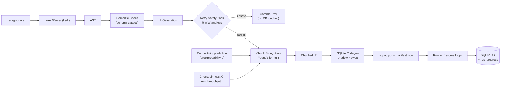

# ChunkSafe — Design Document

A compiler for **interruption-safe database reorganization** on mobile edge databases (SQLite).

## 1. Problem and Goals

Mobile devices lose connectivity or are killed by the OS mid-task. A long reorganization (reindex, repartition, bulk update) that is interrupted can leave the database half-transformed, or can be re-run and corrupt data (e.g. `visits = visits + 1` applied twice).

ChunkSafe compiles a tiny declarative language into SQL that is:

| Property | Mechanism |
|---|---|
| **Resumable** | Work is split into chunks; a progress table records completed chunks. |
| **Idempotent** | Every chunk writes to a *shadow* table with `INSERT OR REPLACE` keyed on the primary key; re-running a chunk yields the same state. |
| **Atomic at the end** | The live table is replaced by the shadow in one transaction (SQLite DDL is transactional). |
| **Provably retry-safe** | A compile-time Read/Write-set pass rejects non-idempotent tasks *before the DB is touched*. |
| **Right-sized** | Chunk size is derived from predicted connectivity using Young's formula. |

Non-goals: general SQL compilation, cross-database portability, concurrent multi-writer correctness.

## 2. Source Language

```
program    := statement*
statement  := reindex | repartition | update
reindex    := "REINDEX" IDENT "ON" "(" IDENT ("," IDENT)* ")" ";"
repartition:= "REPARTITION" IDENT "BY" IDENT ";"
update     := "UPDATE" IDENT "SET" assign ("," assign)* ";"
assign     := IDENT "=" expr
expr       := term (("+"|"-") term)*  ; term := factor (("*"|"/") factor)*
factor     := NUMBER | STRING | IDENT | "(" expr ")"
```

Examples: `REINDEX orders ON (region, ts);` `REPARTITION trips BY zone;` `UPDATE stats SET visits = visits + 1;` (**rejected**).
Comments: `-- to end of line`. Keywords are case-insensitive; identifiers are not.

## 3. System Architecture



Compile-time vs. run-time boundary: everything left of `SQL` happens on the developer/build machine or on-device *before execution*. The schema catalog is supplied as a `--schema` input (a SQLite DB file or JSON) so semantic checks need no live mutation.

## 4. Intermediate Representation

The IR is a **linear list of tasks**; each task later expands to chunks. Python dataclasses in `ir.py`.

```
Program      ::= Task*
Task         ::= id: int
               kind: Kind
               table: Ident
               reads:  frozenset[Column]      -- columns read to compute new values
               writes: frozenset[Column]      -- columns whose values are produced
               spec:   KindSpec
               chunks: Chunk*                 -- empty until sizing pass
Kind         ::= REINDEX | REPARTITION | UPDATE
KindSpec     ::= ReindexSpec(index_cols: Column+)
               | RepartitionSpec(key: Column)
               | UpdateSpec(assignments: (Column, Expr)+)
Expr         ::= Const(v) | ColRef(c) | BinOp(op, Expr, Expr)
Chunk        ::= idx: int, lo: int, hi: int         -- half-open key range [lo, hi) over the chunk key
ChunkPlan    ::= chunk_rows: int, T_opt: float, est_chunks: int   -- attached to Task by sizing
```

Invariants:
- `reads`, `writes` are derived mechanically from `spec` (never user-supplied).
- After the safety pass: `∀ task. task.kind ≠ UPDATE ∨ reads ∩ writes = ∅`.
- After sizing: chunks are contiguous, disjoint, and cover the table key range.
- Chunk key: the table's `INTEGER PRIMARY KEY` / `rowid`. Tables without one use `rowid` (note: `VACUUM` can renumber `rowid` on tables lacking an explicit integer PK; documented limitation).

Read/Write derivation by kind:

| Kind | reads | writes |
|---|---|---|
| `REINDEX t ON (c1..cn)` | `{c1..cn}` | `∅` (data columns untouched; only index structure) |
| `REPARTITION t BY z` | `{z}` | `∅` (rows moved between partitions; values unchanged) |
| `UPDATE t SET a = e, …` | `⋃ cols(e)` | `{a, …}` |

## 5. Chunk Sizing (Young's Formula)

Young's first-order approximation for the optimal checkpoint interval:

```
T_opt = sqrt( 2 · C · D )
```

- `C` — checkpoint cost (seconds): cost of one chunk commit (transaction commit + progress-row write + fsync). Measured by a calibration run or supplied (`--checkpoint-cost`, default 0.02 s).
- `D` — expected time to drop (seconds), i.e. MTBF of the connection.
- `T_opt` — useful work (seconds) to do between checkpoints.

**Obtaining D from the drop probability.** The CLI takes `p ∈ (0,1)`: the probability that a connectivity drop occurs within a reference window `W` (default 60 s). Modelling drops as a Poisson process, `p = 1 − e^(−W/D)`, so

```
D = −W / ln(1 − p)
```

Higher `p` ⇒ smaller `D` ⇒ smaller `T_opt`. (`p→0` ⇒ `D→∞`; clamp to `max_chunk_rows`. `p→1` ⇒ clamp to `min_chunk_rows`.)

**Converting time to rows.** With measured/assumed throughput `r` rows/second:

```
chunk_rows = clamp( floor(T_opt · r), min_rows, max_rows )
n_chunks   = ceil( key_span / chunk_rows )
```

Worked example: `C = 0.02`, `W = 60`, `p = 0.5` ⇒ `D ≈ 86.6 s`, `T_opt = √(2·0.02·86.6) ≈ 1.86 s`; at `r = 5000 rows/s` ⇒ 9 300 rows/chunk. With `p = 0.95`: `D ≈ 20 s`, `T_opt ≈ 0.89 s` ⇒ ~4 450 rows/chunk.

Constraint: Young's formula assumes `T ≪ D`; if `T_opt ≥ D/2` the pass emits a warning and uses `D/2`.

## 6. SQLite Shadow Table / Atomic Swap Strategy

SQLite has no native chunked `REINDEX` or `REPARTITION`; they are simulated with a shadow table. Per task `k` on table `t`:

**State** (created once, `IF NOT EXISTS`):
```sql
CREATE TABLE IF NOT EXISTS _cs_progress(
  job TEXT, task INTEGER, chunk INTEGER, status TEXT,   -- 'done'
  PRIMARY KEY (job, task, chunk));
```

**Phase A — prepare** (idempotent via `IF NOT EXISTS`):
```sql
CREATE TABLE IF NOT EXISTS _cs_shadow_t_k AS SELECT * FROM t WHERE 0;   -- schema copy
-- Real codegen emits explicit DDL (with PK) read from sqlite_master so INSERT OR REPLACE has a key.
```

**Phase B — copy chunk i** (one transaction each; runner skips chunks already `done`):
```sql
BEGIN IMMEDIATE;
INSERT OR REPLACE INTO _cs_shadow_t_k
  SELECT <cols/exprs> FROM t WHERE rowid >= :lo AND rowid < :hi
  ORDER BY <partition/index key>;           -- REPARTITION: ordered by key; UPDATE: exprs applied
INSERT OR REPLACE INTO _cs_progress VALUES (:job, :k, :i, 'done');
COMMIT;
```
Re-running chunk `i` after a crash replays the same `INSERT OR REPLACE` ⇒ same rows ⇒ idempotent. A crash *inside* the transaction is rolled back by SQLite's journal/WAL, so progress and data never disagree.

Why this is only valid when the Safety Pass passes: chunks read from the **original** table `t` (never the shadow), and `t` is not mutated until the swap. Hence replay reads identical inputs. (For `UPDATE`, reading `t` and writing the shadow already removes the physical hazard; the Safety Pass additionally rejects `x = x + 1` because the *language semantics* are non-idempotent — a user re-running the whole script after the swap would double-apply it.)

**Phase C — atomic swap** (single transaction, only when all chunks `done`):
```sql
BEGIN IMMEDIATE;
DROP TABLE t;
ALTER TABLE _cs_shadow_t_k RENAME TO t;
CREATE INDEX idx_t_region_ts ON t(region, ts);      -- REINDEX: build the new index on the shadow-turned-live table
INSERT OR REPLACE INTO _cs_progress VALUES (:job, :k, -1, 'swapped');
COMMIT;
```
SQLite DDL is transactional, so readers see either the old `t` or the new `t`, never neither. The runner checks for the `(-1,'swapped')` marker so the swap is never run twice; if the process died before COMMIT, nothing changed and the swap simply reruns.

**Task-kind mapping**

| Kind | Shadow contents | Final step |
|---|---|---|
| `REINDEX t ON (c…)` | Copy of `t` | Swap, then `CREATE INDEX` on new `t` (indexes built after bulk load = faster) |
| `REPARTITION t BY z` | Copy of `t` physically ordered by `z` (clustered), plus partition-key index | Swap, `CREATE INDEX idx_t_z` |
| `UPDATE t SET a = e` | Copy of `t` with `a` replaced by `e` | Swap |

Triggers, views, and secondary indexes on `t` are recreated from `sqlite_master` DDL captured at compile time. Writes to `t` by the app during reorganization are out of scope (documented assumption: app holds a maintenance lock, or a delta table is future work).

**Executable form.** Pure SQL cannot branch on "chunk already done", so codegen emits one `.sql` file made of blocks introduced by marker comments (`-- @job ID`, `-- @block type=init|prepare|chunk|swap task=K idx=I`); there is no separate manifest. `runner.py` parses the markers and skips blocks already recorded in `_cs_progress`. The file also runs top to bottom in `sqlite3` for a fresh run or a resume: chunk blocks carry a `NOT EXISTS (... done)` guard, and the swap block starts with two guard inserts into `_cs_guard(ok CHECK(ok=1))` that fail (aborting the swap) unless every chunk is `done` and the task has not been swapped yet. Replaying a *finished* script therefore fails safely at the guard instead of destroying data (it may leave an empty `_cs_shadow_*` table; the runner avoids this by skipping swapped tasks). Shadow tables are named `_cs_shadow_<job>_<task>` so an abandoned earlier job can never contribute stale rows.

**Implemented restrictions (CodegenError).** `WITHOUT ROWID` tables are unsupported. `UPDATE` may not assign a PRIMARY KEY / UNIQUE column (`INSERT OR REPLACE` would collapse rows). `REPARTITION` is realised as a key index (`cs_part_<t>_<key>`): rows keep their rowids so replays stay idempotent, hence there is no physical re-clustering. The swap runs with `PRAGMA legacy_alter_table=ON` so views that reference the table do not block the rename. Chunk ranges come from `MIN/MAX(rowid)` at compile time.

## 7. Retry-Safety Pass (Read/Write Sets)

A task is **retry-safe** iff re-executing it on its own output yields the same output (idempotence): `f(f(x)) = f(x)`.

Definitions per task `τ`: `R(τ)` = columns read to compute values; `W(τ)` = columns assigned.

**Rule 1 (intra-task):** reject if `R(τ) ∩ W(τ) ≠ ∅`.
`UPDATE stats SET visits = visits + 1` → `R={visits}`, `W={visits}` → `CompileError: task 1 reads and writes 'stats.visits'; retrying a chunk would apply it twice`.
`UPDATE stats SET visits = 0` → `R=∅` → accepted. `SET b = a * 2` → `R={a}`, `W={b}` → accepted.

**Rule 2 (multi-assignment):** reads are evaluated over the *union* across all assignments in one statement: `SET a = b, b = a` → `R={a,b}`, `W={a,b}` → rejected (swap is order-dependent).

**Rule 3 (inter-task, same table):** for tasks `τi` before `τj` on the same table, if `W(τi) ∩ R(τj) ≠ ∅` the order is *significant*; allowed, but recorded as a dependency edge so the runner never reorders or restarts mid-script. If a later task's writes feed an earlier one (cycle through a rerun of the whole script), emit a warning, not an error.

**Rule 4 (purity):** expressions must be deterministic — only constants, column refs, arithmetic. No `random()`, `datetime('now')`; the grammar excludes function calls, so this holds structurally.

Diagnostics carry source location (line, col) and the offending column. The pass runs on IR *before* sizing; `CompileError` aborts the pipeline with exit code 2 and writes no output.

## 8. Error Model

| Class | Raised by | Example |
|---|---|---|
| `ParseError` | parser | missing `;` |
| `SemanticError` | semantic.py | unknown table/column, duplicate index col |
| `UnsafeRetryError` (`CompileError`) | safety pass | `visits = visits + 1` |
| `SizingError` | sizing pass | `p` outside (0,1), non-positive `C` |

All derive from `CompileError(message, line, col)`.

## 9. Testing Strategy

- Unit: grammar, semantic checks, R/W derivation, sizing numeric table, codegen golden files.
- Property: `p↑ ⇒ chunk_rows↓` monotonic; chunks cover key range exactly once.
- Integration (`test_interruption.py`): run chunked SQL, kill after N chunks (raise inside the runner / terminate subprocess), resume, then assert result equals a one-shot reference reorganization (row-set equality + index existence).
